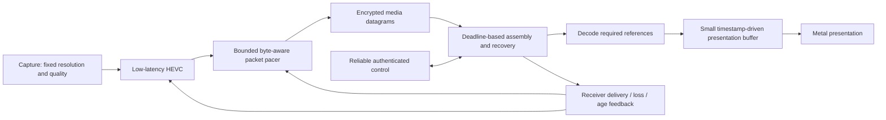

# Wi-Fi stutter research (GPT 6.1 sol via Codex, xhigh, 2026-11-15)

Source: Codex session 01a1e24b-46ba-78d2-b543-795e5589bf4a, read-only review at 2a077a9. Unedited report below.

**The stream is small on average, but this is a deadline problem.** At 60 fps, each frame has a 16.7 ms delivery budget. A link that periodically stops serving the iPad for 80–200 ms can sustain far more than 12 Mb/s and still produce severe stutter.

The evidence supports a compound failure:

1. Wi-Fi introduces delivery gaps and bursts somewhere between Mac submission and iPad frame processing.
2. TCP preserves old video through those gaps.
3. The Mac’s completion-driven scheduler adds sleeps, capture throttling and recovery traffic.
4. The iPad’s single-slot renderer discards frames that arrive together.

**AWDL is a credible contributor, but the measurements do not establish it as the sole cause. iPad power save is also plausible, but neither U-APSD nor Target Wake Time has been demonstrated.** The strongest architectural recommendation is deadline-aware encrypted datagram media, bounded queues, receiver feedback and modest presentation buffering. First, a smaller TCP experiment can establish how much damage comes from the existing scheduler.

This report is based on targeted source inspection at `2a077a9`, git history, the supplied logs and analysis scripts, Apple documentation, standards and vendor/source-code references. I made no file changes and ran no builds, applications or network experiments.

**The pipeline is substantially as described, with several consequential corrections.**

| Component | Verified finding |
|---|---|
| Encoder | HEVC low-latency rate control, real-time operation and frame reordering disabled. `MaxFrameDelayCount=0` is requested, but its return status is unchecked. |
| Rate control | **10 Mb/s is the starting target; the adaptive ceiling is 30 Mb/s**, with a 5 Mb/s floor and 30–60 fps range. Actual encoded output can be substantially lower. |
| Keyframes | A 300-second maximum interval is requested. Recovery can force keyframes; sender-side drop recovery has a 120 ms cooldown. Requested properties are not proof of effective encoder behavior. |
| Active media | `kWirelessUseTCPMedia=YES`; media and Mac-to-iPad control messages use `_inputConnection`, protected by TLS. Both endpoints already enable TCP no-delay. |
| Scheduler | Runs synchronously in the encoder-output/send path. It can sleep up to 45 ms, reject already encoded frames, and request replacement keyframes. |
| iPad receive | TCP receive requests have a minimum of **one byte**, not one whole frame. A length-prefix parser waits for complete messages, then HEVC media passes through the reassembler’s sequencing and callback queues. |
| Renderer | GPU-safe texture ring, but queue capacity **one**: newest wins. Presentation telemetry uses the display link’s target presentation timestamp. |
| Discovery | The iPad browser remains active. The Mac cancels its Bonjour listener after connection readiness. Peer-to-peer remains enabled by default unless the diagnostic argument disables it. |
| Dormant UDP | Packet pacing exists, but there is no FEC. Reassembly retains a two-second incomplete-frame timeout and substantial ordering buffers. Simply changing the TCP-media flag is insufficient. |

Source anchors: [sender configuration and scheduler](./RemoteDesktop/macOS/App/SessionManager.m:60), [TCP media send](./RemoteDesktop/macOS/Transport/WirelessTransport.m:540), [encoder properties](./RemoteDesktop/macOS/Encode/HEVCEncoder.m:105), [iPad receive/parser](./RemoteDesktop/iPadOS/Transport/WirelessTransport.swift:845), [renderer policy](./RemoteDesktop/iPadOS/Render/MetalRenderer.swift:80).

**A. The media stalls are real, but ping cannot identify their location or duration.**

The supplied iPad logs independently show complete-frame processing gaps:

- Run 4 includes consecutive-sequence frame gaps of approximately 203 ms and 125 ms.
- Run 6 includes approximately 141 ms and 436 ms gaps.
- Run 8’s sustained test reports **5,298 observed frames versus 4,324 rendered frames**—about 58.9 versus 48.0 fps across the nominal 90-second window.
- Sampled renderer windows show approximately 120 callbacks/s, negligible semaphore wait and short render callbacks, while recording multiple arrivals between ticks and corresponding queue-cap drops.

These observations establish a problem upstream of presentation. They do **not** yet establish an equally long radio blackout: today’s `frame-arrival` timestamp occurs after TCP framing and reassembler queue handoffs. Source: [frame-arrival instrumentation](./RemoteDesktop/iPadOS/App/SessionManager.swift:672), [TCP media routing](./RemoteDesktop/iPadOS/App/SessionManager.swift:1080).

Ping remains ambiguous because an RTT combines request delivery, iPad response handling and reply delivery. ICMP and media also need not receive identical treatment. Apple explicitly documents that traffic service class principally describes outgoing traffic and does not necessarily determine received-packet priority. Therefore, neither “ICMP is deprioritized” nor “all these ping holds affect TCP identically” is established. [Apple service-class documentation](https://developer.apple.com/documentation/network/nwparameters/serviceclass-swift.enum)

The decisive measurement is a **per-frame timeline with timestamps taken before queue handoffs**:

| Timestamp | Placement | What it isolates |
|---|---|---|
| Capture | Existing capture timestamp | Source cadence |
| Encode submit/output | Immediately around VideoToolbox | Encoder delay and silent output loss |
| Send submission | Immediately before `nw_connection_send` | Application scheduling delay |
| Send completion | Existing callback | Local stack processing/backpressure |
| Receive callback entry | First instruction, before append/parser work | Delivery to the application |
| Frame complete | Immediately when length-prefix parsing completes | Time spent assembling a frame |
| Decode submit/output | Before submission and in decoder callback | Decode and queue delay |
| Actual presentation | Drawable presented handler/time | Presentation delay |

Record frame ID, size, keyframe/reference status, connection generation, queue depths and interface provenance with each event. Batch telemetry in memory; synchronous per-frame console logging could perturb the result.

Apple also provides receive timestamps: `NWProtocolIP.Options.shouldCalculateReceiveTime` and IP metadata’s `receiveTime`. The C equivalents exist in the installed SDK. Apple recommends these specifically to distinguish application scheduling from lower-stack delay. **Check whether useful metadata survives the chosen TLS/TCP stack; datagrams are the cleaner diagnostic case.** Receive time uses `CLOCK_MONOTONIC_RAW`, so convert or calibrate its clock domain before comparing it with the existing Core Animation timestamps. [Apple’s latency investigation procedure](https://developer.apple.com/forums/thread/45210), [receive-time option](https://developer.apple.com/documentation/network/nwprotocolip/options/shouldcalculatereceivetime), [receive-time metadata](https://developer.apple.com/documentation/network/nwprotocolip/metadata/receivetime)

A concurrent, small **encrypted QUIC-datagram probe**, timestamped on receipt and echoed immediately, would distinguish several outcomes:

- **Ping delayed, datagrams/media timely:** ICMP is a misleading proxy.
- **Datagrams timely, TCP late:** investigate TCP recovery, buffering and TLS/application delivery.
- **Lower-stack timestamps timely, callbacks late:** investigate queue scheduling and processing.
- **All traffic delayed before lower-stack reception:** investigate radio/AP service.
- **Send submission itself stops:** the application scheduler or encoder is responsible.

An AP-side or independent over-the-air trace is needed to distinguish sleeping, off-channel operation and retries. A host packet trace alone does not show precisely when a packet crossed the radio. [Apple’s measurement guidance](https://developer.apple.com/forums/thread/45210)

**Several existing measurements need narrower names and stronger provenance.**

- **Send completion is not receiver delivery or a TCP ACK receipt.** Apple defines it as the stack finishing processing the submitted content. A completion can be delayed by local backpressure or callback scheduling; a quick completion can precede substantial outstanding network data. [Apple send-completion semantics](https://developer.apple.com/documentation/network/nwconnection/sendcompletion)
- **Application “in-flight=1” is not one packet or one frame outstanding on the network.** It counts incomplete application send operations. Earlier completed operations may still occupy TCP’s unacknowledged byte range.
- **The logged Mb/s proxy is encoded output, not airtime.** `encoded × average encoded size` excludes retransmission overhead and can include frames later dropped. Receiver accounting occurs after additional processing. Measure encoded, submitted, received and retransmitted bytes separately.
- **“Glass-to-glass” is currently capture-to-target-presentation.** It excludes physical source/display response, and target presentation is not proof of actual presentation. [Renderer timing](./RemoteDesktop/iPadOS/Render/MetalRenderer.swift:610)
- **Clock uncertainty is material.** Run 6 reports clock-sync minimum RTT **65 ms**, median **149 ms**. The implementation takes the median offset from the best-RTT half of ten samples. Path asymmetry can bias absolute latency by tens of milliseconds. Positive-only latency filtering can then bias distributions further. Interarrival gaps and unique-frame counts remain useful without cross-device synchronization. [Clock calibration and filtering](./RemoteDesktop/iPadOS/App/DeviceTestRunner.swift:759)
- **“Wi-Fi” is not sufficient interface provenance.** Run 5 demonstrably included `en13`. Run 3 later logged `awdl0` as interface type Wi-Fi, contradicting the code comment that AWDL appears only as `type_other`. Record actual endpoints and interface identity per connection; do not infer infrastructure `en0` solely from `.wifi` or the application FSM label.
- **“No RTT/rate correlation” does not exclude congestion.** `join.py` uses encoded-output proxies and groups ping replies by arrival second. The adaptive sender also reduces load after bad conditions, creating reverse causality. Short bursts can matter even when per-second means do not.

**B. Root-cause ranking: distinguish the initiating impairment from amplification.**

The most defensible causal model is:

> Intermittent Wi-Fi service or transport delay → accumulated video → burst delivery → presentation overwrites, with completion-driven sleeps and recovery traffic making some episodes worse.

The first arrow’s exact mechanism remains unresolved.

| Candidate | Assessment | Evidence for | Evidence against / missing proof | Discriminating experiment |
|---|---|---|---|---|
| **Mac scheduler and recovery loop** | **Confirmed amplifier; possibly a major avoidable contributor** | Sleeps exceed a 60 fps frame period; post-encode drops create dependency gaps; recovery adds large frames. | Cannot explain independent ping holds. Unchanged scheduler also existed at the later good baseline. | Disable completion-derived sleeps while retaining honest byte/age bounds; hold encoder settings fixed. |
| **TCP backlog and ordered recovery** | **Strong amplifier** | Tiny writes stall after larger frames; application completion count understates network backlog; all downstream media shares byte order. | No packet trace yet distinguishes loss recovery, ACK starvation, receiver-window limitation or local scheduling. | Correlate TCP sequence/ACK progress and receiver timestamps with frame timelines. |
| **AWDL/off-channel coexistence** | **Credible initiating contributor** | Removing this app’s peer-to-peer participation sharply reduced logged slow completions and long sleeps. Apple DTS explicitly warns that peer-to-peer Wi-Fi can add hundreds of milliseconds to infrastructure traffic. | Ping tails and poor rendering remained. System toggles were incomplete controls for all radio activity; periodicity alone is insufficient. | Cancel this app’s discovery during streaming and correlate media stalls with an over-the-air channel/activity trace. |
| **iPad/AP legacy power-save interaction** | **Credible alternative or co-contributor** | Periodic holds, release bursts and relatively healthier gateway RTT fit delayed service to the iPad. | Continuous media and TCP ACK traffic complicate a simple “idle radio sleeps” explanation. No PM/TIM/trigger evidence. | Observe AP client power state and over-the-air PM/Null/trigger/service-period events. |
| **U-APSD specifically** | **Plausible mechanism, unproven** | It delivers queued downlink packets following an uplink trigger, which can resemble bursts. | U-APSD is designed to reduce power while supporting low latency; its presence alone would not establish a defect. Negotiated access categories are unknown. | Identify actual trigger/delivery-enabled categories and correlate trigger-to-delivery timing. |
| **Target Wake Time specifically** | **Lower-confidence hypothesis** | Scheduled service periods can create periodic traffic concentration. | Wi-Fi 6 capability does not establish an active TWT agreement. No negotiation or schedule was captured. | Obtain AP TWT state or capture the actual agreement/service periods. |
| **AP queues, retries, interference, airtime scheduling** | **Credible; insufficiently controlled** | Gateway ping omits the AP-to-iPad service and forwarding path. Both wireless endpoints can contend for airtime. | AP model, band/channel, association details, retries, queue occupancy and mesh topology are absent. | Wire the Mac to the same AP while retaining iPad Wi-Fi; then compare a controlled alternate AP. |
| **Browser left running** | **Cheap, plausible contributor** | It sustains discovery participation; with peer-to-peer enabled, this may sustain additional wireless work. | Ordinary Bonjour browsing is not evidence of a persistent high-rate multicast flood. | Cancel browsing only after authenticated connection establishment; restart on disconnect. |
| **Nagle** | **Low likelihood** | Tiny-write stalls superficially resemble Nagle/delayed-ACK interactions. | Both endpoints explicitly enable no-delay. | Confirm effective configuration and packetization; do not spend another iteration merely setting the same option. |
| **Delayed ACK / ACK compression / cwnd or receive-window stalls** | **Plausible secondary mechanisms** | Large frame followed by tiny frame can leave earlier bytes awaiting ACKs; clustered ACKs can release sends together. | No ACK trace. Sustained 60 fps traffic weakens an ordinary long-idle explanation. | Inspect retransmissions, SACKs, advertised window and ACK spacing during exact episodes. |
| **TLS coalescing / application receive batching** | **Possible delivery contributor** | TCP/TLS boundaries differ from video-frame boundaries; parser and queue handoffs can deliver several frames together. | One-byte minimum receive disproves the specific theory that the API waits for a full configured receive buffer. | Compare lower-stack receive times, callback entry and frame-completion times. |
| **GPU/display throughput** | **Low as the primary cause** | Newest-wins visibly loses bunched arrivals. | USB control and sampled 120 Hz/no-wait renderer telemetry argue against insufficient rendering capacity. | Trace actual presentation alongside decode output and callback timing. |

The protocol facts behind the power-save candidates are documented by [Cisco’s U-APSD description](https://www.cisco.com/c/en/us/td/docs/wireless/controller/9800/17-13/config-guide/b_wl_17_13_cg/m_power_save.html) and [TWT description](https://www.cisco.com/c/en/us/td/docs/wireless/controller/9800/26-1/configuration-guide/wl-26-1-cg/target-wake-time/info-twt.html). Apple’s infrastructure/peer-to-peer warning is unusually direct and closely matches this application: [DTS discussion](https://developer.apple.com/forums/thread/751839).

A-MPDU aggregation, airtime fairness and multicast should therefore remain **mechanisms to inspect**, not diagnoses. Aggregation may expose queueing or service-period effects; mDNS may add traffic or discovery activity. Neither label, without a trace, explains a 500 ms completion.

**A 700-byte write can wait 500 ms because it inherits prior obligations.** Its own serialization time is almost irrelevant:

1. Earlier application sends complete locally, leaving bytes outstanding in TCP.
2. A larger frame consumes available send/congestion/window capacity.
3. The tiny write waits behind that byte range or local stack work.
4. Missing ACK progress, retransmission, delayed radio service or a blocked callback queue delays completion.

TCP delivers an ordered byte stream, so later received bytes cannot bypass a missing earlier range. [TCP specification](https://www.rfc-editor.org/rfc/rfc9293.html)

One qualification matters: TCP has independent byte sequences in each direction. Mac-to-iPad video directly blocks **Mac-to-iPad** control/replies. It does not byte-order-block iPad-to-Mac pointer events; those can still suffer shared radio contention and application queue delays.

The stall-recovery implementation also resets application in-flight accounting and advances its generation without cancelling the underlying TCP connection. **That releases the application gate; it does not drain old network bytes.** It can admit new work while older data remains outstanding. [Recovery implementation](./RemoteDesktop/macOS/App/SessionManager.m:2361)

**The 262/524 ms result is evidence of periodicity, not an AWDL fingerprint.**

Your conversion is correct:

- 256 TU = 262.144 ms.
- 512 TU = 524.288 ms.

The identification as *the* AWDL channel-sequence period is too strong. Published AWDL reverse engineering found 16 TU availability windows, 64 TU extended windows and an announced sequence spanning **1,024 TU**, approximately 1.049 seconds, in the studied implementation. Shorter repeated patterns are possible; modern firmware may differ. The paper does not establish a universal 256 TU cycle. [AWDL research](https://arxiv.org/html/1808.03156)

`period.py` searches many periods and selects the strongest result after thresholding delayed replies. Harmonics and the 100 ms probe cadence require controls. My check at the exact TU periods found increased phase concentration in delayed iPad replies, supporting structured timing, but did not reproduce an equally compelling universal gateway-beacon lock.

For the next analysis, randomize probe intervals, compare delayed replies with all replies and inferred request-send times, and validate a period on a separate time window. Actual beacon/TWT/AWDL observations would turn periodicity into attribution.

**C. The April history does not establish a newly introduced transport regression.**

The history contains both bad and good periods before November:

| Date / commit | Relevant finding |
|---|---|
| April 3, `7b3187c` | Introduced the current TCP-media selection. |
| April 4, including `9b1257d` | Completion-derived scheduler and raised sleep caps already existed. This run recorded 57.8 fps, CV 1.203 and estimated presentation p95 135 ms. |
| April 5, `4869967` | Simplified the renderer to single-frame newest-wins. |
| April 5, `c184c33` | Raised starting bitrate 3.5→10 Mb/s, ceiling 4.6→30 Mb/s and floor 2.5→5 Mb/s; raised burst thresholds. |
| April 6, `c93571e` | Recorded 59.2 fps, CV 0.369 and estimated presentation median/p95 49/59 ms after transport-fallback fixes. |
| **May 8**, `f017d17` | Recorded 59.9 fps and CV 0.259. The approximately 0.26 result belongs to May, not April. |
| November 15 | Added renderer-ring work, input/framing changes, session-queue separation and later diagnostic interface/discovery changes. Run 5 accidentally used USB NCM. |

Crucially, comparing `c93571e` with current HEAD shows:

- **No HEVCEncoder.m changes.**
- The Wi-Fi scheduler constants and operative scheduling body are unchanged.
- Material changes elsewhere include renderer internals, input framing and session/transport queue ownership.

Thus, “the scheduler was added after Wi-Fi worked” is false. “The existing scheduler responds badly to a changed radio/OS environment” remains plausible.

The April iteration log already describes completion tails, queue starvation and recovery oscillations resembling today’s behavior. See [CURRENT.md](./CURRENT.md:699) and [metrics history](./.planning/METRICS.md:134).

There is a larger provenance problem: the earlier good metrics do not prove physical `en0` transport. Today’s accidental USB run reproduced nearly the same excellent HEVC/60 fps result while still being labelled a Wi-Fi run. **This does not prove the old results were wired; it prevents using them as conclusive infrastructure-Wi-Fi baselines.**

The regression experiment should eventually compare the historical and current sender/renderer policies on the **same current OS, physical interface and replay content**. It should not begin with an OS-regression conclusion.

**D. Shipping implementations support datagram media, but “all successful products use UDP+FEC” is false.**

| Product | Publicly supported conclusion | Limits of the evidence |
|---|---|---|
| **Sidecar** | Apple supports wired and wireless second-display operation. [Apple technical brief](https://www.apple.com/macos/big-sur/docs/Sidecar_Tech_Brief_Oct_2019.pdf) | Public material inspected does not specify current packet transport, FEC, pacing or jitter-buffer parameters. Sidecar’s success is not proof of a public radio-control API. |
| **Universal Control** | Shares keyboard/pointer operation between devices. [Apple documentation](https://support.apple.com/en-us/102459) | It is not a remote-video pipeline, so its responsiveness is not evidence that it solves this video workload. |
| **AirPlay mirroring** | Transport varies by operation. UxPlay’s interoperable mirroring receiver explicitly accepts the mirrored-video stream over TCP. [Receiver implementation](https://github.com/FDH2/UxPlay/blob/master/lib/raop_rtp_mirror.c) | This establishes an interoperable mode, not every current Apple-to-Apple mode. It refutes the blanket claim that AirPlay video necessarily uses unreliable UDP. |
| **Moonlight + Sunshine** | GameStream-derived UDP video, packetized frames, Reed–Solomon recovery and sender batching/pacing are visible in source. [Sunshine](https://github.com/SunshineStream/Sunshine/blob/master/src/stream.cpp), [Moonlight receive/FEC queue](https://github.com/moonlight-stream/moonlight-common-c/blob/master/src/RtpVideoQueue.c) | Their precise pacing choices are implementation-specific, not a universal Wi-Fi recipe. FEC cannot repair a complete radio blackout before a deadline. |
| **NVIDIA GameStream** | The GameStream-compatible implementation lineage provides concrete packetization and recovery examples. [Moonlight protocol structures](https://github.com/moonlight-stream/moonlight-common-c/blob/master/src/Video.h) | Do not assume every original NVIDIA behavior equals current Sunshine behavior. |
| **Parsec** | Its BUD transport moved from TCP to custom UDP, with custom congestion/reliability behavior. The original description used DTLS 1.2. [Engineering article](https://parsec.app/blog/a-networking-protocol-built-for-the-lowest-latency-interactive-game-streaming-1fd5a03a6007), [current connectivity requirements](https://support.parsec.app/hc/en-us/articles/32381460716180-Parsec-Connectivity-Requirements) | It is architectural precedent, not a protocol/security implementation meeting your mandatory 1.3 requirement. Exact current recovery details are proprietary. |
| **Steam Link / Remote Play** | Uses both UDP and TCP. Valve exposes network variability in its performance overlay and documents router-specific streaming problems. [Transport requirements](https://help.steampowered.com/en/faqs/view/0689-74B8-92AC-10F2), [network guidance](https://help.steampowered.com/ms/faqs/view/3E3D-BE6B-787D-A5D2) | Port lists do not establish exact FEC, retransmission or jitter-buffer algorithms. |
| **Jump Desktop Fluid** | Supports UDP, TCP and relayed variants; vendor documentation says UDP generally performs best and exposes target bitrate separately from actual bandwidth. [Fluid statistics](https://support.jumpdesktop.com/hc/en-us/articles/4423458049165-Live-Fluid-Connection-Statistics) | FEC and detailed frame-buffer policies are not documented in that source. |
| **Splashtop** | Documents local TCP connections and optimized end-to-end QUIC connections. [Network requirements](https://support-splashtopbusiness.splashtop.com/hc/en-us/articles/115001811966-What-Are-the-Firewall-Exceptions-and-IP-addresses-of-Splashtop-Servers-Services), [QUIC option](https://support-splashtopbusiness.splashtop.com/hc/en-us/articles/9305390384923-Enable-end-to-end-QUIC-connection) | QUIC alone does not establish use of unreliable DATAGRAM frames. |
| **Duet / Luna Display** | Duet offers wireless operation; Luna documents infrastructure, direct peer-to-peer and cable paths, and identifies its proprietary LIQUID protocol. [Duet releases](https://releases.duetdisplay.com/), [Luna connection types](https://support.astropad.com/en/articles/11835445-how-to-check-your-luna-display-connection-type), [LIQUID](https://astropad.com/luna-display-versus-duet-display/) | Public evidence inspected does not establish their packet transport/FEC algorithms. Luna’s comparison with Duet is competitor marketing, not independent technical evidence. |

Frame pacing is a deliberate latency/smoothness tradeoff. Moonlight documents a lowest-latency mode that replaces undisplayed frames, and an Android balanced mode buffering up to one frame to absorb jitter. Its iOS client exposes lowest-latency versus smoothest-video preferences. These are explicit choices, not evidence that one presentation policy wins every workload. [Moonlight pacing documentation](https://github.com/moonlight-stream/moonlight-docs/wiki/Frequently-Asked-Questions), [iOS settings](https://github.com/moonlight-stream/moonlight-ios/blob/master/iPhone.storyboard)

For recovery, Apple itself describes the problem with requesting a large keyframe over an already impaired network and presents acknowledged long-term references as an alternative. **Verify HEVC/M1 encoder support before adopting that technique; the WWDC example is not a blanket compatibility guarantee.** [VideoToolbox low-latency session](https://developer.apple.com/videos/play/wwdc2021/10158/)

**E. Apple has useful controls, but no documented general iPad infrastructure-Wi-Fi “stay awake” switch was established.**

| API / behavior | Relevance to keyd-rd | Entitlement / limitation |
|---|---|---|
| **Wi-Fi Aware `.realtime`** | Explicitly prioritizes latency by changing the Wi-Fi Aware operating tradeoff. Pair it with interactive-video/voice service class. It applies to a **Wi-Fi Aware connection**, not arbitrary `en0` traffic through your home AP. | Requires `com.apple.developer.wifi-aware`, appropriate Publish/Subscribe capabilities and `WiFiAwareServices` declarations. |
| **Wi-Fi Aware on this Mac** | Not an immediately established solution. Apple DTS stated in May 2026 that macOS did not support it despite framework availability. | Require a positive runtime `WACapabilities.supportedFeatures` result on the actual Mac/OS. I found no affirmative evidence superseding that restriction for this M1 Max/macOS 27.2 pairing. |
| **Game Mode** | Apple documents reduced background activity, increased game resources and improved Bluetooth latency. | `LSSupportsGameMode` is an Info.plist key. The documentation inspected does **not** promise suppression of AWDL/scans or infrastructure-Wi-Fi power-save control. Do not disguise a remote desktop as a game to obtain an undocumented side effect. |
| **Interactive-video service class** | Appropriate semantic hint for outgoing video. | No special radio entitlement established. It is not an end-to-end WMM or latency guarantee; verify actual mapping if diagnosing AC behavior. |
| **OS 27 TCP pacing** | `nw_tcp_set_max_pacing_rate` is a public **C API**, present in the installed SDK. It spreads outgoing TCP packets without blocking the encoder callback. | No special entitlement documented. It caps rate; it cannot raise cwnd-limited throughput or eliminate TCP ordering. |
| **L4S** | Potentially useful for queueing congestion on an L4S-capable bottleneck. | Apple documents QUIC support and TCP receiver-side support. It requires cooperating endpoints/bottleneck; it does not cure off-channel absence or sleeping. |
| **Multipath TCP** | Useful when genuine alternative paths exist. | Requires Multipath entitlement. A same-LAN Mac endpoint does not automatically gain a usable cellular alternative, and reliable ordering remains. |
| **Low-Latency Streaming entitlement** | A real Apple capability, but not evidence of an iPad solution. | Apple documents `com.apple.developer.low-latency-streaming` for **visionOS** streamed-game content. |
| **Peer-to-peer policy and browser lifecycle** | Stop this app unnecessarily participating in peer discovery during an established infrastructure session. | Does not require users to disable Continuity features. It also cannot disable other applications’ radio use. |

Sources: [Wi-Fi Aware optimization](https://developer.apple.com/videos/play/wwdc2025/228/), [real-time semantics](https://developer.apple.com/documentation/wifiaware/waperformancemode/realtime), [entitlement/service declarations](https://developer.apple.com/documentation/wifiaware/adopting-wi-fi-aware), [Mac support explanation](https://developer.apple.com/forums/thread/827887), [Game Mode](https://developer.apple.com/videos/play/wwdc2025/209/), [TCP pacing C API](https://developer.apple.com/documentation/network/nw_tcp_set_max_pacing_rate(_:_:)), [L4S limitations](https://developer.apple.com/documentation/network/testing-and-debugging-l4s-in-your-app), [Multipath requirements](https://developer.apple.com/documentation/foundation/improving-network-reliability-using-multipath-tcp), [visionOS entitlement](https://developer.apple.com/documentation/bundleresources/entitlements/com.apple.developer.low-latency-streaming).

`TCP_NOTSENT_LOWAT` is a BSD-socket queue/readiness mechanism, not a latency cure or radio control. Do not assume Linux semantics transfer unchanged to Darwin or that Network.framework exposes its socket for setting it. Prefer supported Network.framework telemetry/pacing before replacing the transport solely to obtain a socket option. [Darwin TCP documentation](https://github.com/apple-oss-distributions/xnu/blob/main/bsd/man/man4/tcp.4)

**The dormant media path has an unresolved security-version assumption.** Both implementations construct DTLS parameters but pass the **TLSv13** enum to the minimum-version setter. That source statement does not prove negotiation of **DTLS 1.3**. The installed `SecProtocolTypes.h` exposes DTLS 1.0/1.2 constants, not DTLS 1.3.

Before using that path, inspect negotiated metadata and verify a handshake capture against the DTLS specification. Do not accept “connection ready” or comments saying “DTLS” as proof of version 1.3. [Apple negotiated-version API](https://developer.apple.com/documentation/security/sec_protocol_metadata_get_negotiated_tls_protocol_version(_:)), [DTLS 1.3 specification](https://www.rfc-editor.org/rfc/rfc9147.html)

QUIC offers a particularly suitable alternative: TLS 1.3 authentication/key establishment plus protected packets, reliable streams and unreliable DATAGRAM frames. Apple exposes datagram configuration through C APIs. This satisfies the TLS 1.3 requirement without assuming native DTLS 1.3 support. QUIC does not carry ordinary TLS records around media packets. [QUIC security](https://www.rfc-editor.org/rfc/rfc9001.html), [QUIC datagrams](https://www.rfc-editor.org/rfc/rfc9221.html), [Apple C datagram configuration](https://developer.apple.com/documentation/network/nw_quic_set_max_datagram_frame_size(_:_:))

**F. Recommended implementation and experiment order.**

All proposed changes preserve the current resolution and image-quality target. Experiments should initially freeze codec settings so a transport improvement cannot be confused with reduced quality or frame rate.

| Priority | Concrete change | Expected effect | Effort | Single proving experiment |
|---|---|---|---|---|
| **1** | Add the timestamp chain, separate byte counters and strict interface provenance. Rename estimated presentation latency. | Establishes where stalls originate and prevents another false Wi-Fi success. | Small–medium | One canonical replay with synchronized frame, TCP and receive timelines; classify every >50 ms episode. |
| **2** | Make infrastructure sessions opt out of this app’s peer-to-peer discovery; cancel the iPad browser once authenticated connections are established, restarting on loss. | May remove avoidable off-channel/discovery activity. | Small | Matched repeated A/B runs changing browser lifecycle only, with system Continuity features left enabled. |
| **3** | Remove completion-derived `usleep` from the encoder callback. Keep honest bounded byte/age accounting and pre-encode admission. | Removes self-imposed cadence gaps and isolates underlying transport behavior. | Medium | Same fixed HEVC output policy, scheduler enabled versus disabled; compare send-submission gaps and rendered-frame gaps. |
| **4** | Test OS 27 kernel TCP pacing on a dedicated media TLS connection; retain separate control TLS. | Tests burst smoothing and control isolation with a smaller change than datagrams. | Medium | Sweep safe pacing rates with identical encoded workload; improvement must appear at receiver frame completion, not just local completions. |
| **5** | Implement QUIC DATAGRAM media with deadlines, bounded packet queues and receiver reports. Keep control reliable. | Prevents obsolete media retransmission/order from holding newer useful data. | Medium–large | Compare TCP and datagram media under identical measured or injected delay/loss, with verified TLS 1.3 and unchanged encoder settings. |
| **6** | Add a small timestamp-driven presentation buffer, initially 0/8.3/16.7 ms options, with a strict age cap. | Recovers some bunched frames and regularizes cadence at a measurable latency cost. | Medium | Replay the same arrival trace through each policy; compare unique presentation cadence and frame age. |
| **7** | Add selective FEC and coordinated codec recovery; coalesce keyframe requests. | Reduces recovery freezes from isolated losses without unnecessary IDR bursts. | Large | Inject isolated and burst losses; measure time to a valid decoded frame, parity overhead and keyframe count. |
| **8** | Diagnose the physical path with Mac Ethernet and a controlled alternate AP. | Separates Mac-radio/two-wireless-endpoint effects from iPad/AP behavior. | Small operationally | Same stream, same iPad Wi-Fi: Mac Wi-Fi versus Ethernet into the same AP. |

For future runs, retain the canonical command and capture:

```bash
./RemoteDesktop/scripts/run-e2e-tests.sh \
  --transport-rotation wifi \
  --profile full \
  --notes "one change under test; verified infrastructure interface"
```

Run matched comparisons more than once, retain the 90-second sustained window, distinguish it from whole-session results, and record AP/channel/interface/OS/build provenance. Run 5 must remain excluded from Wi-Fi causal comparisons. The peer-to-peer counts—359→79 slow-completion log records and 213→15 long sleeps—are encouraging, but sampled logging, differing windows and unchanged poor presentation prevent treating them as a complete fix.

**The preferred production architecture is reliable control plus deadline-aware media.**



Use native Network.framework QUIC from C/Objective-C on the Mac, with a reliable control stream and DATAGRAM media flow; alternatively retain existing TLS control during migration. A single QUIC connection can separate reliable and unreliable semantics without TCP-style cross-message retransmission blocking, although the flows still share congestion and radio resources. [QUIC DATAGRAM behavior](https://www.rfc-editor.org/rfc/rfc9221.html)

The media implementation needs:

- **Packet-size-aware pacing**, not frame-count-based sleeping.
- **Queue age and byte bounds**, including awareness that already accepted transport data cannot simply be recalled.
- **Frame/chunk IDs and explicit deadlines**; an expired incomplete frame must not wait two seconds.
- **Decoder dependency discipline**: decode required reference frames even when their presentation is skipped. Dropping an arbitrary encoded P-frame is not equivalent to dropping a captured frame before encoding.
- **Receiver feedback** covering arrival gaps, useful delivery, losses, decode continuity and presentation age.
- **FEC only where it helps**; spend additional bandwidth first on avoiding recovery without altering image quality.
- **Coordinated recovery** rather than independent sender/receiver keyframe requests.

Do not restore the old UDP path unchanged. Its 1,400-byte application datagrams still require accounting for transport/security overhead; its fixed chunk spacing and second-scale recovery policies need review against measured path capacity and frame deadlines.

**Pacing rate must allow large frames to finish promptly.** A 425 KB frame needs roughly:

| Effective delivery rate | Serialization time, before extra stalls/overhead |
|---:|---:|
| 10 Mb/s | 340 ms |
| 100 Mb/s | 34 ms |
| 200 Mb/s | 17 ms |

Therefore, pacing at merely 1.2–1.5 times a 10 Mb/s average could make large-frame latency worse. Set packet pacing from demonstrated short-timescale delivery capacity and a burst/deadline budget, with congestion feedback. Kernel TCP pacing is useful precisely because it paces packets, but a poorly chosen ceiling still creates a queue. [Apple pacing semantics](https://developer.apple.com/documentation/network/nw_tcp_set_max_pacing_rate(_:_:))

For encoder behavior, check every property-setting result and query effective capabilities. `AverageBitRate` is not a per-frame limit. `DataRateLimits` can constrain bytes over time windows, but Apple notes codec support varies; a tight cap can trade away quality or frames, violating this task’s constraint. It should not be the first fix. [Apple rate-limit documentation](https://developer.apple.com/documentation/videotoolbox/kvtcompressionpropertykey_dataratelimits)

A small presentation buffer is justified as an experiment despite the earlier two-frame FIFO latency regression. That earlier test does not evaluate every timestamp/deadline policy or a repaired transport. However, **no 8–17 ms buffer can conceal a 100 ms radio blackout**, and FEC cannot reconstruct packets that have not arrived. If traces confirm such blackouts, the remaining work is radio/AP diagnosis or Apple escalation, with packet evidence and a minimal encrypted reproducer.

The unresolved facts are specific: actual Wi-Fi power state and TWT negotiation; exact AWDL activity during media stalls; TCP retransmission/window behavior; native DTLS negotiated version; and the physical interface used by the historical good runs. None requires the owner to disable AirDrop, Handoff or Universal Control, and none should be replaced by another round of scheduler constants without measuring the missing boundary.

Codex session ID: 01a1e24b-46ba-78d2-b543-795e5589bf4a
Resume in Codex: codex resume 01a1e24b-46ba-78d2-b543-795e5589bf4a
